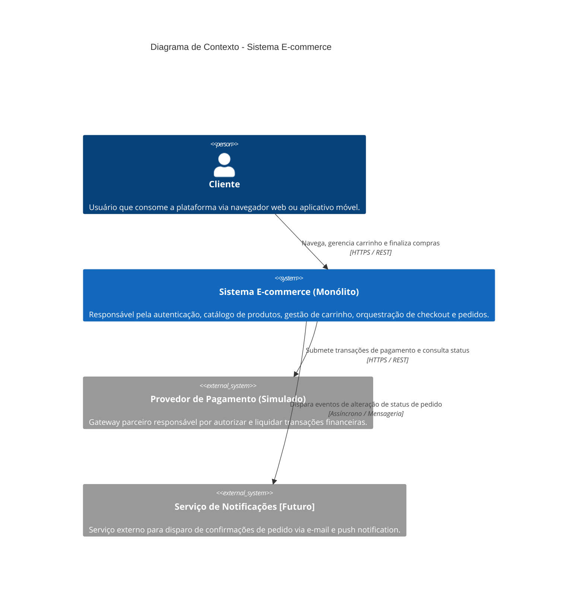

# C4 - Diagrama de Contexto

O diagrama de contexto apresenta as fronteiras do sistema de e-commerce, seus atores diretos e as integrações externas planejadas.

## Descrição dos Elementos
- **Cliente:** Usuário final autenticado ou anônimo que interage com a vitrine e realiza pedidos.
- **Sistema E-commerce (Monólito):** Core do negócio construído como uma aplicação unificada com módulos bem isolados, centralizando a lógica de e-commerce.
- **Provedor de Pagamento (Simulado):** Integração externa com gateway para autorização de cobranças (mock no ambiente de desenvolvimento).
- **Serviço de Notificações (Futuro):** Ponto de evolução arquitetural para integração desacoplada via mensageria para disparo de e-mails transacionais e avisos.
