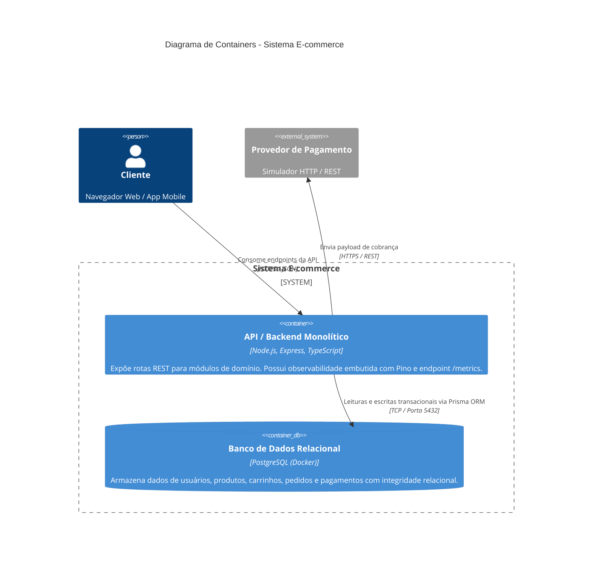

# C4 - Diagrama de Containers

O diagrama de containers detalha as unidades de execução implantáveis do sistema, protocolos de comunicação e tecnologias adotadas.

## Detalhamento dos Containers
1. **API / Backend Monolítico:**
   - **Tecnologia:** Node.js 22, Express, TypeScript.
   - **Responsabilidades:** Roteamento HTTP, execução das regras de negócio organizadas por módulos, controle de acesso e exposição de telemetria.
   - **Observabilidade embutida:** 
     - Geração e propagação de `x-request-id` por requisição.
     - Logs estruturados via `pino` enviados para `stdout`.
     - Endpoints de instrumentação: `GET /health` e `GET /metrics`.
2. **PostgreSQL (Docker):**
   - **Tecnologia:** Imagem oficial `postgres:16-alpine`.
   - **Responsabilidades:** Persistência transacional com suporte a constraints, chaves estrangeiras e índices para catálogo e pedidos.
