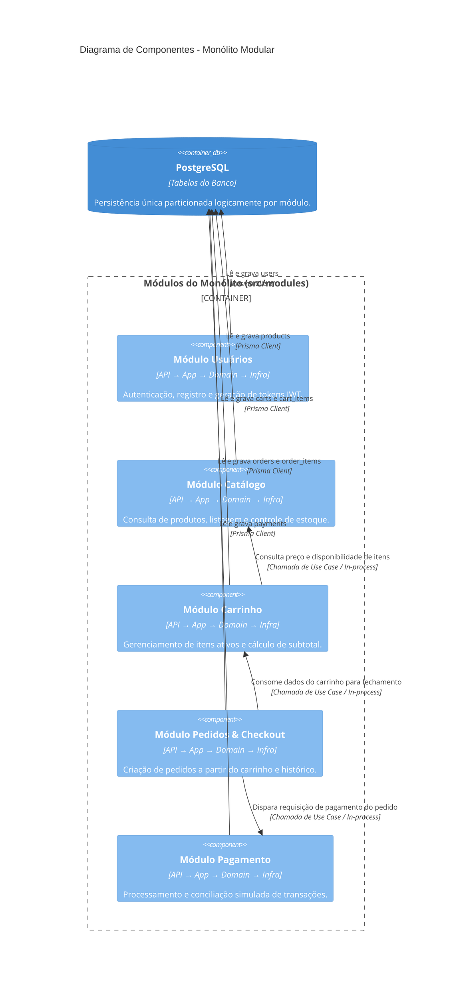
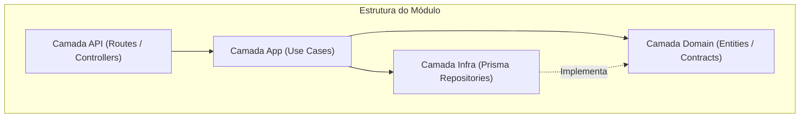

# C4 - Diagrama de Componentes

O diagrama de componentes ilustra a organização interna do backend monolítico modular. Cada módulo de negócio possui limites claros e segue a divisão em quatro camadas padronizadas.

## Padrão de Camadas por Módulo
Cada módulo (`usuarios`, `catalogo`, `carrinho`, `pedidos`, `pagamento`) é estruturado em:
- **api:** Rotas Express, controllers e validação de schema de entrada.
- **app (use cases):** Orquestração dos fluxos de negócio específicos daquele domínio.
- **domain:** Entidades de domínio, tipos, contratos de repositório e regras puras.
- **infra:** Acesso a dados (Prisma/Postgres) e integração com serviços externos.

## Fluxo Interno em Cada Módulo

### Regras de Acoplamento Modular
1. Um módulo não acessa tabelas de outro módulo diretamente via SQL ou Prisma de forma desordenada.
2. Comunicação entre módulos em tempo de execução ocorre por chamadas diretas a use cases ou interfaces de serviço expostas pelo módulo de destino.
3. Não há dependências circulares entre os módulos.
