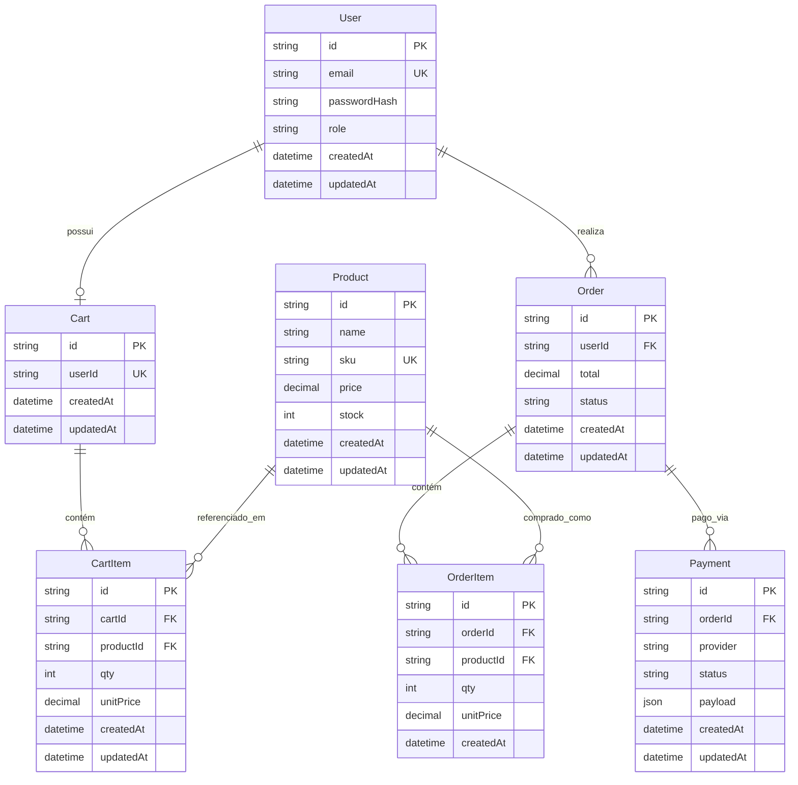

# Modelo de Dados Relacional

O esquema relacional é implementado no PostgreSQL com suporte a transações ACID e integridade referencial.

## Diagrama Entidade-Relacionamento (ER)

## Dicionário de Tabelas

### 1. `users`
| Coluna | Tipo | Modificadores | Descrição |
| :--- | :--- | :--- | :--- |
| `id` | UUID / String | PK | Identificador único do usuário |
| `email` | VARCHAR(255) | UNIQUE, NOT NULL | E-mail corporativo ou pessoal para autenticação |
| `passwordHash` | VARCHAR(255) | NOT NULL | Hash seguro da senha gerado com bcrypt |
| `role` | VARCHAR(50) | NOT NULL, DEFAULT 'CUSTOMER' | Papel do usuário (`CUSTOMER`, `ADMIN`) |
| `createdAt` | TIMESTAMP | DEFAULT NOW() | Data de registro |
| `updatedAt` | TIMESTAMP | DEFAULT NOW() | Data da última alteração |

### 2. `products`
| Coluna | Tipo | Modificadores | Descrição |
| :--- | :--- | :--- | :--- |
| `id` | UUID / String | PK | Identificador único do produto |
| `name` | VARCHAR(255) | NOT NULL | Nome de exibição do produto |
| `sku` | VARCHAR(100) | UNIQUE, NOT NULL | Código único de identificação comercial |
| `price` | DECIMAL(10,2)| NOT NULL | Preço unitário atual |
| `stock` | INT | NOT NULL, DEFAULT 0 | Quantidade disponível em estoque |
| `createdAt` | TIMESTAMP | DEFAULT NOW() | Data de cadastro |
| `updatedAt` | TIMESTAMP | DEFAULT NOW() | Data de atualização |

### 3. `carts`
| Coluna | Tipo | Modificadores | Descrição |
| :--- | :--- | :--- | :--- |
| `id` | UUID / String | PK | Identificador do carrinho |
| `userId` | UUID / String | UNIQUE, NOT NULL, FK(`users.id`) | Dono do carrinho ativo |
| `createdAt` | TIMESTAMP | DEFAULT NOW() | Criação da sessão de carrinho |
| `updatedAt` | TIMESTAMP | DEFAULT NOW() | Última modificação |

### 4. `cart_items`
| Coluna | Tipo | Modificadores | Descrição |
| :--- | :--- | :--- | :--- |
| `id` | UUID / String | PK | Identificador do item |
| `cartId` | UUID / String | NOT NULL, FK(`carts.id` ON DELETE CASCADE) | Carrinho ao qual pertence |
| `productId` | UUID / String | NOT NULL, FK(`products.id`) | Produto adicionado |
| `qty` | INT | NOT NULL, CHECK(qty > 0) | Quantidade selecionada |
| `unitPrice` | DECIMAL(10,2)| NOT NULL | Preço unitário no momento da inserção |
| `createdAt` | TIMESTAMP | DEFAULT NOW() | Data de adição |
| `updatedAt` | TIMESTAMP | DEFAULT NOW() | Data de alteração |

### 5. `orders`
| Coluna | Tipo | Modificadores | Descrição |
| :--- | :--- | :--- | :--- |
| `id` | UUID / String | PK | Identificador do pedido |
| `userId` | UUID / String | NOT NULL, FK(`users.id`) | Cliente comprador |
| `total` | DECIMAL(10,2)| NOT NULL | Valor total consolidado do pedido |
| `status` | VARCHAR(50) | NOT NULL, DEFAULT 'PENDING' | Status (`PENDING`, `PAID`, `CANCELLED`) |
| `createdAt` | TIMESTAMP | DEFAULT NOW() | Data e hora de fechamento |
| `updatedAt` | TIMESTAMP | DEFAULT NOW() | Data da última mudança de status |

### 6. `order_items`
| Coluna | Tipo | Modificadores | Descrição |
| :--- | :--- | :--- | :--- |
| `id` | UUID / String | PK | Identificador do item de pedido |
| `orderId` | UUID / String | NOT NULL, FK(`orders.id` ON DELETE CASCADE) | Pedido pai |
| `productId` | UUID / String | NOT NULL, FK(`products.id`) | Produto faturado |
| `qty` | INT | NOT NULL | Quantidade adquirida |
| `unitPrice` | DECIMAL(10,2)| NOT NULL | Preço unitário congelado no fechamento |
| `createdAt` | TIMESTAMP | DEFAULT NOW() | Data de registro |

### 7. `payments`
| Coluna | Tipo | Modificadores | Descrição |
| :--- | :--- | :--- | :--- |
| `id` | UUID / String | PK | Identificador da transação |
| `orderId` | UUID / String | NOT NULL, FK(`orders.id`) | Pedido associado ao pagamento |
| `provider` | VARCHAR(50) | NOT NULL | Provedor do gateway (ex: `SIMULATED_GATEWAY`) |
| `status` | VARCHAR(50) | NOT NULL, DEFAULT 'PENDING' | Status (`PENDING`, `APPROVED`, `REJECTED`) |
| `payload` | JSONB / TEXT | NOT NULL | Resposta/detalhes retornados pelo gateway |
| `createdAt` | TIMESTAMP | DEFAULT NOW() | Data de envio da cobrança |
| `updatedAt` | TIMESTAMP | DEFAULT NOW() | Data da confirmação ou recusa |
